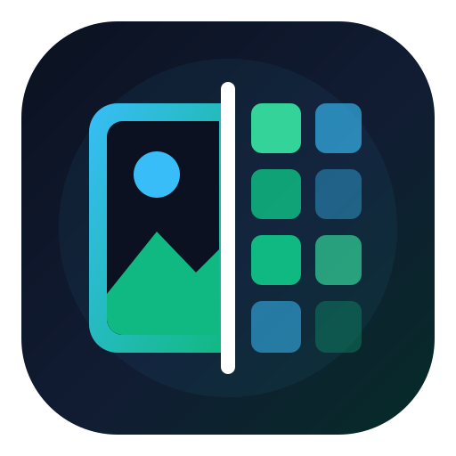
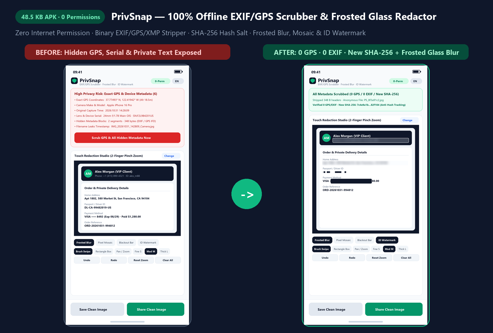
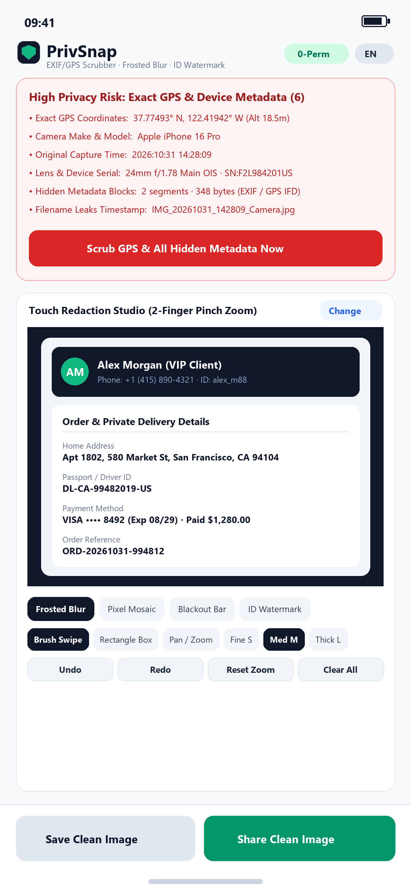
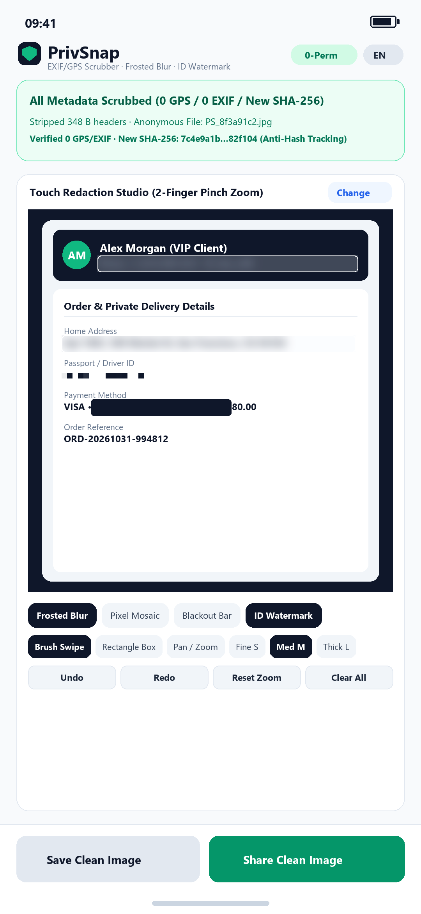

<div align="center">
  
  <h1>PrivSnap (净图)</h1>
  <p><strong>48 KB Zero-Permission Android EXIF/GPS Scrubber, Anti-Hash Re-Encoder & Frosted Glass Redactor</strong></p>
  <p>
    <a href="https://github.com/shrorse-ai/privsnap/releases/download/v1.0.0/privsnap-1.0.0.apk"></a>
    
    
  </p>
</div>

---

<div align="center">
  
</div>

---

## 🛡️ Why PrivSnap?

Every time you share a camera photo or screenshot on Reddit, Discord, WhatsApp, Telegram, or marketplace listings:
1. **Camera Photos Leak Your Exact Location & Hardware ID**: Original JPEGs/PNGs/WebPs silently embed binary `EXIF` and `GPS IFD` headers containing your exact **latitude/longitude down to the building**, **altitude**, **capture timestamp**, **phone model**, **OS build**, and **camera serial number**.
2. **Default Filenames Leak Timestamps & Source Apps**: Filenames like `IMG_20261031_142809.jpg` or `Screenshot_20261031_com.whatsapp.png` reveal exactly when the photo was taken and which app it came from.
3. **Standard Blur Can Be Reversed**: Naive pixelation or single-pass blur filters over sensitive text can sometimes be reconstructed via deconvolution, and unmodified image files can be tracked across platforms via **SHA-256 file hash matching**.

**PrivSnap** solves all three in **48.5 KB** of pure, auditable Java with **zero third-party SDKs** and **zero Android permissions**.

---

## ✨ Key Features

- **🔒 Truly Zero Permissions (`0-Perm`)**:
  - Does **not** request `android.permission.INTERNET` or `READ_EXTERNAL_STORAGE` / `READ_MEDIA_IMAGES`.
  - Run `aapt2 dump permissions privsnap-1.0.0.apk` — the output is completely empty. The Android OS kernel guarantees PrivSnap can never connect to the network or snoop on your gallery.
- **📍 Binary-Level EXIF / GPS / XMP Inspector & Stripper**:
  - Parses raw JPEG (`APP1`–`APP15`, `COM`), PNG (`eXIf`, `tEXt`, `zTXt`, `iTXt`, `tIME`), and WebP chunks on-device to show you exactly what hidden metadata your photo is leaking before you share it.
  - Strips 100% of non-pixel metadata segments and re-verifies the output byte stream (`0 GPS / 0 EXIF`).
- **🧬 SHA-256 Anti-Tracking Hash Salt + Anonymous Filename**:
  - Applies an imperceptible 1-LSB perturbation to 4 corner pixels during export so every scrubbed image generates a **brand-new cryptographic SHA-256 hash**, preventing cross-platform image hash correlation.
  - Automatically renames outputs to anonymous random filenames (`PS_8f3a91c2.jpg`).
- **🌫️ Irreversible Frosted Glass Blur, Pixel Mosaic & Blackout Studio**:
  - **Frosted Glass Blur**: 3-pass separable box blur combined with micro-luminance grain diffusion so redacted phone numbers, names, balances, and addresses cannot be reversed.
  - **Pixel Mosaic & Solid Blackout**: Classic block pixelation and high-contrast blackout bars.
  - **Brush Swipe & Rectangle Box + 2-Finger Pinch-to-Zoom**: Zoom up to `5x` to redact tiny text accurately, with full `Undo / Redo / Clear`.
- **🪪 ID Card & Document Anti-Theft Watermark**:
  - One-tap repeating diagonal security watermark (`"FOR VERIFICATION ONLY · DO NOT REUSE"`) to protect ID scans, driver's licenses, leases, and contracts from unauthorized reuse.
- **📲 Android System Share Sheet Target (`Share ➔ PrivSnap`)**:
  - Share any photo or screenshot directly from your Gallery or browser into PrivSnap, scrub in 3 seconds, and tap **Share Clean Image** or **Save Clean Image**.

---

## 📱 Screenshots

<div align="center">
  
  &nbsp;&nbsp;&nbsp;
  
</div>

---

## 📥 Download & Verification

- **Latest Release**: [`v1.0.0` (`privsnap-1.0.0.apk`)](https://github.com/shrorse-ai/privsnap/releases/download/v1.0.0/privsnap-1.0.0.apk)
- **Obtainium Support**: Add `https://github.com/shrorse-ai/privsnap` directly in [Obtainium](https://github.com/ImranR98/Obtainium) for automatic updates.
- **Package ID**: `io.privsnap.app`
- **Minimum Android Version**: Android 8.0+ (API 26+)
- **Signed APK Size**: `49,634 bytes` (`48.5 KB`)
- **Declared Permissions**: **None (`0`)**
- **SHA-256 Checksum (`privsnap-1.0.0.apk`)**:
  ```text
  a26346d6178127fb07a708c4bb7229655ccb0ce7fc5bdf9ec861f3716bd52258
  ```

---

## 🛠️ Build & Verify from Source

PrivSnap is written in 100% pure Android SDK Java (only 5 source files under `app/src/main/java/io/privsnap/app/`) with zero external dependencies:

```powershell
# Builds the signed APK, asserts 0 permissions via aapt2, and runs all 25 binary EXIF/GPS unit tests
.\scripts\verify.ps1
```

---

## 🇨🇳 中文说明 · 净图 (PrivSnap)

**「净图 (PrivSnap)」** 是一款安装包仅 **48.5 KB**、**0 权限申请（无联网权限、无相册窥探权限）** 的纯离线照片去定位与截图打码工具，支持中英双语自适应与一键切换。

- **真实二进制 EXIF / GPS 深度剥离**：直接解析并抹除照片中暗藏的精确经纬度、海拔、拍摄时间、手机品牌型号、镜头序列号与隐藏数据块。
- **防追踪哈希重构 + 随机匿名文件名**：导出时自动生成 `PS_xxxxxxxx.jpg` 匿名文件名并刷新文件 SHA-256 指纹。
- **苹果风毛玻璃打码 / 像素马赛克 / 纯黑遮挡 + 证件防盗水印**：支持手指涂抹、矩形拉框、双指放大 5 倍精细打码，内置含真实二进制 GPS/EXIF 的测试样张，装上第一秒即可体验。

---

## 📄 License

Released under the [MIT License](LICENSE).
